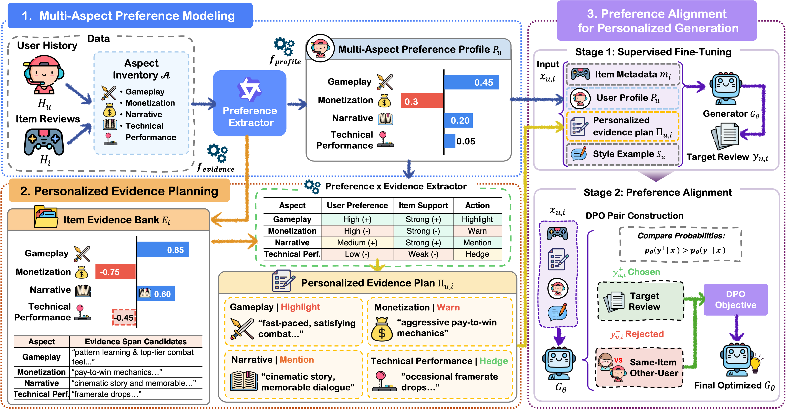

<div align="center">

<h1>🍁 Grounding What Users Care About: Multi-Aspect Personalized Modeling from Implicit Preferences</h1>

<p>
  <a href="https://2026.aaclnet.org/">
    
  </a>
  
  
</p>

<p>
  <a href="https://idsl.hanyang.ac.kr/members/students/%EB%B0%95%EC%A7%80%EC%9D%B8">
    <strong>Jiin Park</strong>
  </a>,
  <strong>Misuk Kim*</strong>
</p>

<p>
  <sub>* Corresponding author</sub>
</p>

<p>
  📄 <strong>Paper</strong> (Coming Soon)
  &nbsp;|&nbsp;
  <a href="https://github.com/jiin124/maple_artifacts">💻 <strong>Code</strong></a>
  &nbsp;|&nbsp;
  <a href="https://huggingface.co/anonymousanonyauthor/games-asde-qwen25-3b-lora">🤗 <strong>Games Extractor</strong></a>
  &nbsp;|&nbsp;
  <a href="https://huggingface.co/anonymousanonyauthor/books-asde-qwen25-3b-lora">🤗 <strong>Books Extractor</strong></a>
  &nbsp;|&nbsp;
  <a href="https://amazon-reviews-2023.github.io/">📚 <strong>Base Dataset</strong></a>
</p>

</div>

---

📌 This is the official repository for **MAPLE (Multi-Aspect PersonaLized Modeling with Evidence)**, accepted to the **Main Conference of AACL-IJCNLP 2026**.

MAPLE addresses personalized generation when user preferences are **implicit, multifaceted, and must remain grounded in target-specific evidence**. Instead of compressing a user into a single representation or directly injecting raw histories, MAPLE structures user preferences at the aspect level and connects them to evidence supported by the target item before generation.

## 🧭 Method Overview

MAPLE consists of three main stages:

1. **Multi-Aspect Preference Modeling** — extracts aspect-level preference tuples from a user's history and aggregates them into an interpretable **Multi-Aspect Preference Profile**.
2. **Personalized Evidence Planning** — constructs an item-side **Evidence Bank** and selects evidence-supported points that match the user's important aspects to form a **Personalized Evidence Plan**.
3. **Preference Alignment for Personalized Generation** — trains the generator with **SFT** and then applies **same-item counterfactual DPO** to better align generations with the target user's preferences.

<br>
<p align="center">
  
</p>

### 💡 Why MAPLE?

Conventional personalization methods may retrieve raw user histories or compress them into a single embedding/profile without explicitly checking whether personalized content is supported by the current item. MAPLE separates **what the user cares about** from **what can be supported about the target item**, then connects the two through an explicit evidence plan.

---

## 🚀 Release Scope

This repository contains the **public downstream implementation** of MAPLE for personalized review generation.

The released pipeline starts from **sentence-level preference labels** and includes scripts for:

- aggregating sentence-level labels into review-level labels,
- building item evidence banks,
- constructing multi-aspect user profiles,
- generating personalized evidence plans,
- building generator SFT data,
- constructing same-item counterfactual DPO pairs, and
- LoRA-based SFT/DPO training.


## 🗂️ Repository Structure

```
scripts/
  aggregate_review_labels.py
  build_item_evidence_bank.py
  build_user_profiles.py
  build_same_item_counterfactual_pairs.py
  build_personalized_evidence_plans.py
  build_generator_sft_dataset.py
  train_generator_sft_lora.py
  build_counterfactual_dpo_dataset.py
  train_generator_dpo_lora.py

examples/sample/
  books_aspect_lexicon.json
  books_sample_interactions.jsonl
  books_sample_items.jsonl
  books_sample_labeled_sentences.jsonl
  games_aspect_lexicon.json
  games_sample_interactions.jsonl
  games_sample_items.jsonl
  games_sample_labeled_sentences.jsonl

README.md
requirements.txt
.gitignore

```

The `examples/sample/` files are intended for smoke testing and format inspection only. For full experiments, replace these paths with the processed dataset paths used in your environment.

## ⚙️ Installation

Python 3.10 or later is recommended.

```
pip install -r requirements.txt
```

The pinned versions in `requirements.txt` follow the environment used for development. If your CUDA or PyTorch setup differs, install a compatible `torch` build first and then install the remaining packages.

## 🧩 Input Formats

### 🏷️ Sentence-level preference labels

`books_sample_labeled_sentences.jsonl` and `games_sample_labeled_sentences.jsonl` should contain one sentence per line. Each row must include `review_id`, `user_id`, `item_id`, `sent_id`, `sentence`, and `labels`.

```
{"review_id":"r1","user_id":"u1","item_id":"i1","sent_id":"r1_s0","split":"train","rating":5,"item_title":"Example Item","sentence":"The gameplay is smooth and replayable.","labels":[{"a":"Gameplay mechanics","d":"smooth gameplay","s":1,"e":{"text":"gameplay is smooth","char_start":4,"char_end":22}}]}
```

Each label has the form `(a, d, s, e)`, where `a` is the aspect name, `d` is a descriptor phrase, `s` is sentiment polarity in `{-1, 0, 1}`, and `e` is the evidence span.

### 👤 Interactions

`books_sample_interactions.jsonl` and `games_sample_interactions.jsonl` should contain one review interaction per line.

```
{"review_id":"r1","user_id":"u1","item_id":"i1","split":"train","rating":5,"review_text":"The gameplay is smooth and replayable.","item_title":"Example Item","timestamp":1700000000}
```

### 📦 Items

`books_sample_items.jsonl` and `games_sample_items.jsonl` should contain item metadata.

```
{"item_id":"i1","item_title":"Example Item","title":"Example Item","description":"A short item description."}
```

### 🧠 Aspect lexicon

The sample commands below use domain-specific aspect lexicons: `examples/sample/books_aspect_lexicon.json` for Books and `examples/sample/games_aspect_lexicon.json` for Games.

```
{"lexicon":[{"aspect_name":"Gameplay mechanics"},{"aspect_name":"Replayability and long-term engagement"}]}
```

A plain list of aspect names is also supported.

## 🔄 Pipeline

### 1. 🧾 Aggregate sentence-level labels into review-level labels

```
python scripts/aggregate_review_labels.py \
  --labeled_sentences_path examples/sample/books_sample_labeled_sentences.jsonl \
  --aspect_lexicon_path examples/sample/books_aspect_lexicon.json \
  --output_path outputs/sample/books_review_labels.jsonl \
  --overwrite
```

```
python scripts/aggregate_review_labels.py \
  --labeled_sentences_path examples/sample/games_sample_labeled_sentences.jsonl \
  --aspect_lexicon_path examples/sample/games_aspect_lexicon.json \
  --output_path outputs/sample/games_review_labels.jsonl \
  --overwrite
```

### 2. 🏦 Build item evidence banks

```
python scripts/build_item_evidence_bank.py \
  --labeled_sentences_path examples/sample/books_sample_labeled_sentences.jsonl \
  --items_path examples/sample/books_sample_items.jsonl \
  --aspect_lexicon_path examples/sample/books_aspect_lexicon.json \
  --output_path outputs/sample/books_item_evidence_bank.jsonl \
  --allowed_splits train \
  --overwrite
```

### 3. 👥 Build multi-aspect user profiles

```
python scripts/build_user_profiles.py \
  --labeled_sentences_path examples/sample/books_sample_labeled_sentences.jsonl \
  --aspect_lexicon_path examples/sample/books_aspect_lexicon.json \
  --output_path outputs/sample/books_user_profiles.jsonl \
  --summary_output_path outputs/sample/books_user_profiles_summary.json \
  --allowed_splits train \
  --shrinkage_c 5.0 \
  --overwrite
```

### 4. 🗺️ Build personalized evidence plans

```
python scripts/build_personalized_evidence_plans.py \
  --interactions_path examples/sample/books_sample_interactions.jsonl \
  --items_path examples/sample/books_sample_items.jsonl \
  --user_profiles_path outputs/sample/books_user_profiles.jsonl \
  --item_evidence_bank_path outputs/sample/books_item_evidence_bank.jsonl \
  --aspect_lexicon_path examples/sample/books_aspect_lexicon.json \
  --output_path outputs/sample/books_personalized_evidence_plans.jsonl \
  --target_splits train,val,test \
  --overwrite
```

### 5. 🛠️ Build generator SFT data

```
python scripts/build_generator_sft_dataset.py \
  --personalized_evidence_plans_path outputs/personalized_evidence_plans.jsonl \
  --interactions_path examples/sample/books_sample_interactions.jsonl \
  --aspect_labels_path examples/sample/books_sample_labeled_sentences.jsonl \
  --aspect_lexicon_path examples/sample/books_aspect_lexicon.json \
  --output_dir outputs/generator_sft \
  --prefix generator_sft \
  --splits train,val,test \
  --num_style_examples 5 \
  --overwrite
```

This step writes split files such as `generator_sft_train.jsonl`, `generator_sft_val.jsonl`, `generator_sft_test.jsonl`, and `generator_sft_all.jsonl`.

### 6. 🔀 Build same-item counterfactual pairs

```
python scripts/build_same_item_counterfactual_pairs.py \
  --interactions_path examples/sample/books_sample_interactions.jsonl \
  --items_path examples/sample/books_sample_items.jsonl \
  --user_profiles_path outputs/sample/books_user_profiles.jsonl \
  --item_evidence_bank_path outputs/sample/books_item_evidence_bank.jsonl \
  --aspect_lexicon_path examples/sample/books_aspect_lexicon.json \
  --output_path outputs/sample/books_same_item_counterfactual_pairs.jsonl \
  --target_splits train \
  --peer_splits train \
  --min_review_chars 40 \
  --overwrite
```

The sample file must contain at least one item reviewed by multiple users to produce non-empty same-item counterfactual pairs.

### 7. ⚖️ Build generator DPO data

```
python scripts/build_counterfactual_dpo_dataset.py \
  --sft_all_path outputs/generator_sft/generator_sft_all.jsonl \
  --same_item_pairs_path outputs/dpo_pairs_same_item_counterfactual.jsonl \
  --output_dir outputs/generator_dpo \
  --prefix counterfactual_dpo \
  --splits train,val \
  --overwrite
```

This step writes files such as `counterfactual_dpo_train.jsonl`, `counterfactual_dpo_val.jsonl`, and `counterfactual_dpo_all.jsonl`.

## 🏋️ Training

### 🎯 SFT

```
python scripts/train_generator_sft_lora.py \
  --model_id Qwen/Qwen2.5-7B-Instruct \
  --train_path outputs/generator_sft/generator_sft_train.jsonl \
  --eval_path outputs/generator_sft/generator_sft_val.jsonl \
  --output_dir models/generator_sft_lora \
  --num_train_epochs 2 \
  --per_device_train_batch_size 1 \
  --gradient_accumulation_steps 16 \
  --learning_rate 2e-5 \
  --max_length 4096 \
  --gradient_checkpointing \
  --bf16
```

### 🔁 DPO

```
python scripts/train_generator_dpo_lora.py \
  --base_model Qwen/Qwen2.5-7B-Instruct \
  --sft_adapter_path models/generator_sft_lora \
  --train_path outputs/generator_dpo/counterfactual_dpo_train.jsonl \
  --eval_path outputs/generator_dpo/counterfactual_dpo_val.jsonl \
  --output_dir models/generator_dpo_lora \
  --num_train_epochs 1 \
  --per_device_train_batch_size 1 \
  --gradient_accumulation_steps 16 \
  --learning_rate 5e-6 \
  --max_length 4096 \
  --max_prompt_length 2300 \
  --gradient_checkpointing \
  --bf16
```

For memory-constrained GPUs, add `--load_in_4bit` to the SFT or DPO training command.

## 📝 Notes

This release focuses on the downstream MAPLE construction and generator training pipeline. The sentence-level preference labels are assumed to be precomputed. The same-item counterfactual DPO stage uses the target user's actual review as the chosen response and another user's real review for the same item as the rejected response.

## 📚 Citation

If you use MAPLE in your research, please cite:

```bibtex
@inproceedings{park2026maple,
  title     = {Grounding What Users Care About: Multi-Aspect Personalized Modeling from Implicit Preferences},
  author    = {Park, Jiin and Kim, Misuk},
  booktitle = {Proceedings of the 5th Asia-Pacific Chapter of the Association for Computational Linguistics and the 15th International Joint Conference on Natural Language Processing},
  year      = {2026}
}
```

